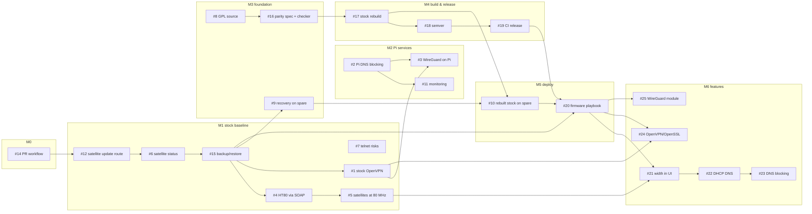

# Roadmap

**End goal:** a custom firmware for the MR70 router and MS70 satellites that:
- keeps every stock behavior: admin login and session/XSRF handling, the SOAP API used by the Nighthawk app and `tools/netgear_router.py`, the web pages including `debug.htm`, the Wi-Fi Blanket mesh (`wbd_master`/`wbd_slave`, `ieee1905`, `acos_agent`), OpenVPN, DDNS and the firmware-update path
- adds the features stock lacks (5 GHz width, DHCP DNS option, outbound DNS blocking, current VPN software)
- is **built and published by CI** as a semantic-versioned release
- is installed with a tested **backup → install → verify → rollback** procedure ([firmware-playbook.md](firmware-playbook.md))

The backlog is ordered so that each issue can be finished and merged on its own, and each one makes the next step safer. Tracking issue: **#26** (pinned). This page explains the order. The issues hold the task lists.

**Guiding rule:** use what stock firmware already has first, then services on a Raspberry Pi, and only then custom firmware. Nothing is flashed until there's a proven recovery path (#9) and a backup (#15), and the spare unit always goes first.

## How the backlog is worked
- **Milestones in order (M0 → M6), issues top to bottom within a milestone.** #8 is the exception: it waits on NETGEAR and can run in the background at any time.
- **One issue = one feature branch = one PR against `main`.** The branch is `<type>/<issue>-<slug>` (each issue names it). Commits and PR titles follow [Conventional Commits](https://www.conventionalcommits.org/); the PR body says `Closes #N`. Details: [CONTRIBUTING.md](../CONTRIBUTING.md). Nobody, human or agent, commits on `main`.
- **Every change keeps `tools/check-repo.sh` green.** Firmware images, extracted files, `.cfg` backups and logs are never committed.
- **Evidence or it didn't happen:** firmware facts go into [findings.md](findings.md) with paths, function addresses or NVRAM keys.

## Milestones

| Milestone | Issues, in order | Done when |
|---|---|---|
| **M0 Process & guardrails** | #14 | `main` is protected; PRs and commit messages are linted |
| **M1 Stock baseline** (no flashing) | #12 → #6 → #15 → #4 → #5 → #7 → #1 | Satellite update route, backups and the DFS fix work on stock; stock VPN and telnet documented |
| **M2 Pi services** | #2 → #11 → #3 | Ad blocking, monitoring and WireGuard run on a Pi next to stock firmware |
| **M3 Firmware foundation** | #8 · #9 → #16 | GPL source in hand; stock re-flashed on a spare through a recovery path; parity spec and checker exist |
| **M4 Build & release pipeline** | #17 → #18 → #19 | Unmodified stock rebuilds reproducibly; tags publish semver releases with checksums, SBOM and attestation |
| **M5 Deploy & install** | #10 → #20 | Rebuilt stock runs on the spare; the firmware playbook has been executed, including a rollback |
| **M6 Custom features** | #21 → #22 → #23 → #24 → #25 | Each feature ships as its own minor release and passes the parity check |

## Related project: home-ad-blocker
[llevintza/home-ad-blocker](https://github.com/llevintza/home-ad-blocker) runs AdGuard Home on a Raspberry Pi 4 and enforces ad blocking at the network layer, with no per-device setup. It's a feature planned for the near future. Its design needs three things from the router:

| home-ad-blocker needs | Stock MR70 | Covered by |
|---|---|---|
| Custom DNS server handed out by DHCP | **No** (`www/LAN_lan.htm`: only `dhcp_server` on/off + range) | Workaround in #2 (router WAN DNS → Pi, or Pi serves DHCP); firmware feature #22 |
| DHCP reservation by MAC (static Pi address) | Yes (LAN Setup → Address Reservation) | #2 |
| Outbound blocking: TCP/UDP 853, port 53 to anything but the Pi, DoH endpoints | **No** | Firmware feature #23 |

Until #22 and #23 ship, #2 documents what works on stock firmware and which home-ad-blocker phases have to wait.

---

## Facts per milestone

### M1: stock features (no flashing)

#### Stock OpenVPN server (#1)
**Status:** present in the stock firmware, disabled by default, never enabled or tested on the owner's hardware, and nothing implemented in this repo yet. Verified in MR70 1.0.5.50 (paths relative to the extracted rootfs):
- **Binary and libraries:** `bin/openvpn` is **OpenVPN 2.4.9** (built with OpenSSL, LZO, LZ4), linked against `lib/libssl.so.1.1` = **OpenSSL 1.1.1n**.
- **Web UI:** `www/OPENVPN.htm`, reachable from the menu item `advanced_vpnservice` (`www/start.htm`): ADVANCED → Advanced Setup → **VPN Service**. Client config downloads are separate for Windows, non-Windows and smartphones.
- **NVRAM defaults** (`tools/nvram_defaults.py` on `bin/acos_nvram`):

  | Key | Default |
  |---|---|
  | `openvpnActive` | `disable` |
  | `openvpn_iface_type` | `tun` |
  | `openvpn_protocol_tun` / `openvpn_service_port_tun` | `udp` / `12973` |
  | `openvpn_protocol` / `openvpn_service_port` | `udp` / `12974` (TAP) |
  | `openvpn_tun_ipaddr` / `netmask` | `192.168.254.1` / `255.255.255.0` |
  | `openvpn_redirectGW` | `auto` (choose whether all traffic or only home traffic goes through the VPN) |

- **Needs:** a public IPv4 address on the router's WAN (not CGNAT), Dynamic DNS (`www/DNS_ddns.htm`, NETGEAR DDNS supported), and OpenVPN clients on phone and laptop.
- **Caveats:**
  - OpenVPN 2.4 and OpenSSL 1.1.1 are both **end-of-life upstream** (the custom-firmware upgrade is #24).
  - Certificate generation and cipher defaults are unexamined.
  - Enabling it opens a UDP port to the internet.

#### DFS exposure (#4, #5)
The factory 44/160 setting always includes DFS channels (findings §4). The web UI can't change the width; the SOAP call `Set5GWLANWPAPSKByPassphrase` can. #4 implements it in `tools/netgear_router.py`, and #5 verifies whether satellites follow (`cb_satallite_wl1_chanspec`). The firmware UI option is #21.

### M2: Raspberry Pi services
A Pi 3B+ or newer, on Ethernet next to the router, with a static address.
- **#2 DNS blocking.** There's no DHCP DNS option (see the home-ad-blocker table), which leaves two setups:

  | Option | How | Pros | Cons |
  |---|---|---|---|
  | **1. Router forwards to the Pi** | Internet Setup → Domain Name Server = *Use these DNS servers* → the Pi | One setting; router DHCP stays on; easy rollback | Pi sees every query as coming from the router |
  | **2. Pi serves DHCP** | Router DHCP off; Pi serves DHCP with the router as gateway | Per-device stats and blocking | Pi becomes critical; verify satellites rejoin |

  Start with option 1. Rollback: DNS back to "Get automatically", or re-enable the router's DHCP.
- **#11 Monitoring:** the 5 s ping monitor from the case study, plus a periodic `currentsetting.htm` firmware-parity check on each unit.
- **#3 WireGuard** (PiVPN or wg-easy) with one UDP port forwarded (`www/FW_forward*.htm`). It's maintained independently of NETGEAR. Optional extra: **Unbound** as a recursive resolver on the same Pi.

### M3–M5: custom firmware foundation, pipeline, install
**Nothing gets flashed without an explicit decision by the owner and a tested recovery path.** Building images in Docker or CI is in scope from M4. Flashing is not, until #9 and #15 are done, and then only on the spare unit first.

Feasibility (as of 2026-11):
- **Platform:** Broadcom **BCM6756**, BCA SDK 5.04L.02p1, Linux **4.19.183**. The image is a NETGEAR CHK header + FIT (findings §1).
- **OpenWrt:** no support. There's no target for this SoC family, and Broadcom's Wi-Fi driver is closed. Mainline Linux has only a basic BCM6756 device tree, without Wi-Fi.
- **NETGEAR GPL source (#8):** the official GPL index (`https://www.downloads.netgear.com/files/GDC/2649_GPLv1.html`, entry "MK72 / MK73 / MK73S / MR70 / MS70") lists MR70 and MS70 packages for 1.0.2.26 … **1.0.5.50** (`files/GPL/MR70-V1.0.5.50_src.zip`, `MS70-V1.0.5.50_src.zip`). **On 2026-11-03 every `files/GPL/` download returned HTTP 404**; no mirror was found, and no checksums are published.
- **Expected contents (inferred from other NETGEAR GPL drops; unverified):** kernel, open-source userland, the ACOS build system, and **prebuilt binaries** for Broadcom Wi-Fi and mesh (`wl`, `wbd_*`, `acsd2`). A rebuilt image keeps Wi-Fi only if those blobs are present.
- **Recovery (#9):** nmrpflash does **not** list MR70/MS70 as tested (one MS70 report timed out), and no UART pinout has been published. A bad flash could permanently brick a unit, which is why a spare MS70 comes first.
- **Feature parity (#16):** the spec lists what "keeps all existing behavior" means, and `tools/parity_check.py` compares stock and rebuilt rootfs trees. Every custom release must pass it.
- **Releases (#18, #19):** release-please turns conventional commits into `vX.Y.Z` tags and a changelog (`feat` = minor, `fix` = patch, a release that needs recovery to install or roll back = major). Each tag publishes a **public GitHub Release** with MR70 and MS70 `.chk` images, `SHA256SUMS`, an SBOM, a build-provenance attestation, a NOTICE and the corresponding GPL source. The images contain closed NETGEAR/Broadcom binaries. The owner chose public releases knowing the licensing risk (2026-11-03).
- **Install (#10, #20):** [firmware-playbook.md](firmware-playbook.md).

### M6: custom features, in risk order
1. **#21** 5 GHz width selector in the web UI (DFS fix)
2. **#22** DHCP DNS server option (home-ad-blocker)
3. **#23** Outbound DNS/DoT/DoH blocking (home-ad-blocker)
4. **#24** Current OpenVPN/OpenSSL
5. **#25** WireGuard kernel module (backport for 4.19)

Telnet already exists (the satellite `debug.htm` has an Enable Telnet control; findings §7). An open shell is a security risk; #7 documents it, and it stays off.

---

## Research log
| Date | Item | Result |
|---|---|---|
| 2026-11-03 | OpenVPN in stock MR70 1.0.5.50 | Present: OpenVPN 2.4.9 / OpenSSL 1.1.1n; disabled by default; UDP 12973 (TUN) / 12974 (TAP); menu ADVANCED → Advanced Setup → VPN Service |
| 2026-11-03 | DHCP DNS option for Pi-hole | Not in the web UI (`LAN_lan.htm` has only `dhcp_server` on/off and the range) |
| 2026-11-03 | NETGEAR GPL source for MR70/MS70 | Listed for 1.0.5.50 and older; all `files/GPL/` downloads return 404 today, so the build attempt is blocked |
| 2026-11-03 | OpenWrt support for BCM6756 | None (no target; closed Broadcom Wi-Fi) |
| 2026-11-03 | Recovery tools | nmrpflash: MR70/MS70 untested, one failed MS70 report; no published UART pinout |
| 2026-11-03 | Backlog | Reordered into milestones M0–M6 towards custom firmware (#26); release images go to public GitHub Releases (owner decision) |
